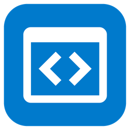

# LoupixDeck.Plugin.VSCode


A [LoupixDeck](https://github.com/RadiatorTwo/LoupixDeck) plugin for Visual Studio Code. It puts
the editor's features, and what the editor knows, on the deck, so you can see and reach them
without hunting through panels and menus:

- 139 keys and 23 dials for VS Code commands: files, navigation, editing, search, layout, the
  terminal, Source Control, the debugger, tasks and tests, Copilot and Claude Code, and the
  accessibility tools and focus moves;
- live keys that show the window's errors and warnings, git branch and changes, debugger state,
  unsaved files, active file and cursor position, the last task's and terminal command's result,
  and whether screen reader mode is on;
- folders that put live content on the keys, one item per key: tasks, launch configurations,
  problems, open editors, recent folders, terminals and windows. Press one to run or open it;
- keys for one task, one launch configuration, one folder, or any command by its ID.

Keys run commands by ID through a small companion extension, so they keep working when you
rebind a shortcut, use another keyboard layout, or switch to VS Code Insiders, VSCodium, Cursor
or Windsurf. Without the companion, keys that have a default shortcut press it instead.

Built against `LoupixDeck.PluginSdk` 1.30.0 and targets .NET 10. Runs on macOS, Windows and
Linux, with the limits listed under [Platform support](#platform-support).

Made by [**web-engineer**](https://www.web-engineer.co.uk/)
([@web-engineer](https://github.com/web-engineer)).

This is an independent project and is not affiliated with or endorsed by Microsoft. Visual
Studio Code is a trademark of Microsoft Corporation.

## Platform support

| Feature | macOS | Windows | Linux |
|---|---|---|---|
| Keys and dials through the companion | Yes | Yes | Yes |
| Live keys and folders | Yes | Yes | Yes |
| Bringing the right window to the front | Yes (VS Code 1.128 or later; older versions bring back the app's last window) | Yes, as macOS | Yes, as macOS |
| Fallback shortcuts without the companion | Yes | Yes. The editor is brought forward through its `vscode://` link, else its command-line launcher | Yes, as Windows |
| Installing the companion from the settings page | Yes | Yes | Yes |

The companion talks to the plugin over a Unix domain socket on macOS and Linux and a named pipe
on Windows. Fallback shortcuts send key presses; on macOS they need the Accessibility permission
that LoupixDeck already asks for.

The plugin has been tested on macOS. The Windows and Linux code paths are built and unit tested
but not yet tried on those systems; please report what you find.

## Install

1. Copy the build output into the plugin folder:

   | OS | Folder |
   |---|---|
   | macOS, Linux | `~/.config/LoupixDeck/plugins/vscode/` |
   | Windows | `%APPDATA%\LoupixDeck\plugins\vscode\` |

   The folder must contain `LoupixDeck.Plugin.VSCode.dll`, its `.deps.json`, `icon.png`,
   `plugin.json` and `loupixdeck-companion.vsix`.
2. Restart LoupixDeck, then enable the plugin for your device under Plugins → Installed.
3. Open the plugin's settings and press **Install companion in Visual Studio Code** (or in your
   editor; there is one button for each editor found). Open windows connect within a few
   seconds.

Keys with a default shortcut work straight away. Live keys, folders and keys without a shortcut
need the companion.

## The companion extension

The **LoupixDeck Companion** (`web-engineer.loupixdeck-companion`) is a small VS Code extension
in [`extension/`](extension/). Every VS Code window runs its own copy, which:

- runs the commands the deck sends, by ID, with arguments;
- pushes the window's state to the deck as it changes: problems, git, debugger, tasks,
  terminal, active file, unsaved files and screen reader mode;
- answers the deck's folders with the window's tasks, launch configurations, problems, open
  editors, recent folders and terminals, and runs the one you press;
- brings its window to the front before a key acts, so with several windows open the deck acts
  on the one in front, else on the one you used last.

It has no dependencies, no telemetry and makes no network requests.

### Installing it

The plugin ships the extension as `loupixdeck-companion.vsix` in its folder. Either:

- press **Install companion in …** on the plugin's settings page, which runs the editor's own
  command-line launcher for you; or
- install it yourself:

  ```bash
  code --install-extension ~/.config/LoupixDeck/plugins/vscode/loupixdeck-companion.vsix
  ```

  Use `code-insiders`, `codium`, `cursor` or `windsurf` for the other editors, or run
  **Extensions: Install from VSIX…** in the editor and pick the file.

After an update, reload each open window (**Developer: Reload Window**). The status bar shows
**Deck** with a plug icon while the deck is connected. The extension's settings, commands and
troubleshooting are on their own page: [docs/companion-extension.md](docs/companion-extension.md).

### Security model

The deck can run any command, and some commands run code (tasks, terminals), so the companion
only accepts connections from your own user account:

- Each window listens on a Unix domain socket in a folder only you can open
  (`~/.config/LoupixDeck/vscode/`, mode `0700`), or on a named pipe on Windows. Nothing listens
  on a network port, so web pages and other computers cannot reach it.
- Every connection must start with a random 32-byte token, new each time the window starts. The
  token is in a registration file only you can read (mode `0600`). The companion checks it in
  constant time and closes the connection on a wrong one.
- Any program running as you can read that file, just as it could already run anything else as
  you. To limit what the deck may do, set `loupixdeck.commandPolicy` to `allowList` and list the
  command IDs in `loupixdeck.allowedCommands`. Both are read from your user settings only, so a
  folder's `.vscode/settings.json` cannot loosen them.
- Every command the deck runs is written to the **LoupixDeck** output channel. The token is
  never logged.

Commands from the deck still follow VS Code's workspace trust rules, so tasks stay blocked in an
untrusted folder. The wire protocol is documented in [docs/PROTOCOL.md](docs/PROTOCOL.md).

### Remote windows

The companion is a UI extension: it runs on your computer even in SSH, container and WSL
windows, so the deck reaches those windows too. In a remote window the git state comes from the
git extension's commands, polled every 2 seconds while the window has focus and every 10 seconds
otherwise.

### Forks

The companion works in any editor built on VS Code 1.93 or later, and reports which editor it
runs in, so keys and live state need nothing more. The settings page offers to install it in
VS Code, VS Code Insiders, VSCodium, Cursor and Windsurf. For fallback shortcuts the plugin needs
to know which editor to press them in: the **Editor for shortcuts** setting (below).

## Settings

| Setting | Key | Default | Notes |
|---|---|---|---|
| Bring the editor to the front first | `bring_to_front` | on | Off: commands still run in the window used last, but fallback shortcuts go to whichever app has focus |
| Editor for shortcuts | `app` | `auto` | Which editor gets fallback shortcuts: `auto` (the one running, else the first installed), `code`, `insiders`, `codium`, `cursor` or `windsurf` |

The settings page shows whether the companion is installed and which windows are connected.
Buttons on the settings page:

- **Install companion in *editor***: one for each editor found. Installs or updates the companion with the editor's command-line launcher.
- **Check connection**: looks for companion windows now and lists them.
- **Get support**: opens [web-engineer.co.uk/contact](https://web-engineer.co.uk/contact).
- **Report a bug or request a feature**: opens this repository's issues.

## Example layout for the Loupedeck CT

[`Profiles/LoupeDeck-CT-example.loupixprofile`](Profiles/LoupeDeck-CT-example.loupixprofile)
is a ready-made **VS Code** workspace for the Loupedeck CT, designed for everyday use and for
getting round the editor without a mouse. It has five touch pages, both dial columns and the
wheel. To use it:

1. Install and enable the plugin, and install the companion (see [Install](#install)).
2. In LoupixDeck, choose **Import Package…** (in *Settings › Profiles* or the header menu) and
   select the file.
3. The preview shows the workspace and the plugin it needs. Import it as a copy into the profile
   you want it in.
4. Switch to the *VS Code* workspace.

The first page puts the window's state where you can see it at a glance. The last page is given
to accessibility: screen reader mode, the tools that read things out, and the focus moves that
are the quickest way round the window from the keyboard.

| Page | Row 1 | Row 2 | Row 3 |
|---|---|---|---|
| **Code** | *Target window* · *Active file* · *Problems* · *Git status* | Go to file · Command Palette · Find in files · *Unsaved files* | Side bar · Panel · Terminal · Open editors folder |
| **Edit** | Undo · Redo · Format document · Quick fix | Rename symbol · Toggle line comment · Go to definition · Go to references | Select next match · Add cursor below · Fold all · Unfold all |
| **Debug & Run** | *Debugger status* · Launch configurations folder · Tasks folder · *Task status* | Step over · Step into · Step out · Toggle breakpoint | Restart · Stop · Run all tests · *Terminal status* |
| **Source & AI** | Source Control · Stage all · Commit · Sync | Pull · Push · Checkout branch · Graph | Copilot Chat · Inline chat · Agent mode · Claude Code |
| **Accessibility** | *Screen reader mode* · Accessible View · Accessibility help · Show hover | Focus editor · Focus side bar · Focus panel · Focus status bar | Problems folder · Accessibility signals · Reset zoom · Accessibility settings |

Keys in *italics* are live keys.

| Control | Top | Middle | Bottom |
|---|---|---|---|
| Left dials | Editor tabs (press: pick a recent editor) | Problems (press: Problems panel) | Diffs: changed blocks in the file (press: peek at the change) |
| Right dials | Window zoom (press: reset) | Editor scroll (press: focus the editor) | Debug step: left steps out, right steps over (press: continue) |

The wheel has four modes: Scroll, Editor tabs, Problems and Navigation history.

*Claude Code* needs the Claude Code extension (without it the key shows `Needs Claude Code`),
and the chat keys need Copilot set up in VS Code. Everything else is built in.

The package is generated from the plugin's own key designs by
[`tools/ProfileBuilder`](tools/ProfileBuilder/Program.cs), so every key looks exactly as if you
had assigned it in the editor. After changing a command's look or the layout, regenerate it from
a checkout with LoupixDeck next to this repository:

```bash
dotnet run --project tools/ProfileBuilder
```

A test fails if the package no longer matches the plugin's commands.

## Keys and commands

Command ids are permanent. VS Code keys share one look: white icons and text on VS Code blue
(`#007ACC`). Live keys change colour with their state: red for errors and failures, amber for
warnings, unsaved changes and a paused debugger, green for success, dark grey when there is
nothing to show. Each key gets ordinary layers you can restyle in the button editor.

Commands come in 13 groups in the command picker: *VS Code* (the editor, windows, live keys,
folders and parameterised keys), *Files*, *Navigate*, *Edit*, *Search*, *View*, *Terminal*,
*Source Control*, *Debug*, *Run & Test*, *AI*, *Accessibility* and *Dials*.

### Live keys

Live keys read the state the window last pushed, so they cost nothing to show and change as soon
as the editor does. Every live key also has an `offline` state (dark grey) for when no window is
connected; it then says `No companion` (an editor runs without it), `Not running` (an editor is
installed but closed), `No VS Code` or `Update plugin`.

| Command id | Shows | States | Tap |
|---|---|---|---|
| `VSCode.Window` | The window keys act on: workspace and editor | `connected`, `offline` | Opens the Windows folder |
| `VSCode.ActiveFile` | File name, line and column, language | `normal`, `dirty` (amber) | Shows the file in the Explorer |
| `VSCode.Problems` | `3 errors` / `5 warnings` / `No problems` | `clean` (green), `warnings` (amber), `errors` (red) | Next problem |
| `VSCode.Git` | Branch, changed files, `↑1 ↓2` | `clean` (green), `changes` (amber), `conflicts` (red), `none` (no repository) | Sync when ahead or behind, else Source Control |
| `VSCode.Unsaved` | `2 unsaved` / `All saved` | `saved` (green), `unsaved` (amber) | Save all |
| `VSCode.DebugState` | `Running` / `Paused`, the session and why it stopped | `inactive`, `running` (green), `paused` (amber) | Start debugging, pause or continue |
| `VSCode.TaskStatus` | The running task, or the last one and its exit code | `idle`, `running`, `ok` (green), `failed` (red) | Run the last task again |
| `VSCode.TerminalStatus` | The terminal's last command and exit code (needs shell integration) | `idle`, `ok` (green), `failed` (red) | Show or hide the terminal |
| `VSCode.ScreenReader` | Screen reader mode `On` / `Off` / `Auto` | `on` (green), `off` | Toggle screen reader mode |

The problems dial (`VSCode.ProblemSteps`) also shows the count next to the dial: `3 err`, `5 warn` or `OK`.

### Folders

These keys open a folder with one key per item from the window keys act on. Problems are red or
amber by severity; the active editor and terminal are highlighted. When there are more items than
keys, the last key is **More ›** and the host's Back key returns to the previous page; dial 0
turns pages forward. An open folder refreshes itself when the list changes in the editor.

| Command id | Lists | Press |
|---|---|---|
| `VSCode.Windows` | Every connected window: workspace and editor | Brings it to the front, which also makes it the window keys act on |
| `VSCode.Tasks` | Tasks, as in **Run Task** | Runs it |
| `VSCode.DebugConfigs` | Launch configurations and compounds | Starts debugging |
| `VSCode.ProblemList` | The first 40 problems, errors first, as `file:line` and message | Opens the file there |
| `VSCode.OpenEditors` | Open editor tabs, `●` marking unsaved ones | Switches to it |
| `VSCode.Recent` | Recently opened folders and workspaces | Opens it in the current window |
| `VSCode.TerminalList` | Integrated terminals and their last command | Shows it |

### Parameterised keys

| Command id | Parameters | What it does |
|---|---|---|
| `VSCode.Open` | – | Brings the VS Code window you used last to the front, starting the editor if needed |
| `VSCode.OpenFolder` | `Path` (e.g. `~/Documents/site` or a `.code-workspace` file) | Opens it in a new window, or switches to the window that already has it. Without the companion it uses the editor's command-line launcher |
| `VSCode.RunTask` | `Task` (a label from **Run Task**, e.g. `build`) | Runs that task |
| `VSCode.Debug` | `Configuration` (a name from `launch.json`, the `.code-workspace` file or user settings) | Starts debugging that configuration or compound |
| `VSCode.Run` | `Command`, `Args` | Runs any command by its ID, see below |

### Any command: `VSCode.Run`

`VSCode.Run(Command,Args)` runs any VS Code command, built in or from an extension. Find a
command's ID in the Keyboard Shortcuts editor (right-click a command → **Copy Command ID**).
`Args` is optional JSON:

- a JSON array is the argument list;
- any other JSON value (an object, a number, `true`) is the only argument;
- text that is not JSON is passed as one string argument.

LoupixDeck splits key parameters on commas, so `Args` cannot contain one. Write `;` wherever the
JSON needs a comma, and the key turns each `;` back into `,` before parsing. A `;` inside a
quoted string stays a semicolon, so `{"text":"cd src; npm test\n"}` types both commands:

| Command | Args | Runs |
|---|---|---|
| `editor.action.formatDocument` | (empty) | Format document |
| `workbench.action.terminal.sendSequence` | `{"text":"npm test\n"}` | Types `npm test` and Enter into the terminal |
| `editorScroll` | `{"to":"down";"by":"page"}` | Scroll down a page |
| `workbench.action.openSettings` | `editor.fontSize` | Settings, filtered to the font size |
| `vscode.open` | `[{"$uri":"file:///Users/me/notes.md"}]` | Opens that file |

An object `{"$uri":"file:///…"}` anywhere in the arguments becomes a file URI. When a command
is not registered (an extension that is not installed), the key shows `Needs extension`; a key
with no window connected shows `Needs companion`.

### Command keys and dials

Every key runs its VS Code command through the companion. The shortcut columns are what it
presses instead when no companion window is connected (see the next section); `–` means the key
needs the companion. Keys marked with an extension id need that extension.

#### VS Code Files

| Command id | Key | VS Code command | macOS | Windows | Linux |
|---|---|---|---|---|---|
| `VSCode.QuickOpen` | Go to file | `workbench.action.quickOpen` | Cmd+P | Ctrl+P | Ctrl+P |
| `VSCode.NewFile` | New file | `workbench.action.files.newUntitledFile` | – | – | – |
| `VSCode.NewExplorerFile` | New file in Explorer | `explorer.newFile` | – | – | – |
| `VSCode.NewExplorerFolder` | New folder in Explorer | `explorer.newFolder` | – | – | – |
| `VSCode.OpenRecent` | Open recent | `workbench.action.openRecent` | Ctrl+R | Ctrl+R | Ctrl+R |
| `VSCode.Save` | Save | `workbench.action.files.save` | Cmd+S | Ctrl+S | Ctrl+S |
| `VSCode.SaveAll` | Save all | `workbench.action.files.saveAll` | Alt+Cmd+S | Ctrl+K S | – |
| `VSCode.CloseEditor` | Close editor | `workbench.action.closeActiveEditor` | Cmd+W | Ctrl+F4 | Ctrl+W |
| `VSCode.CloseOtherEditors` | Close other editors | `workbench.action.closeOtherEditors` | Alt+Cmd+T | – | – |
| `VSCode.CloseAllEditors` | Close all editors | `workbench.action.closeAllEditors` | Cmd+K Cmd+W | Ctrl+K Ctrl+W | Ctrl+K Ctrl+W |
| `VSCode.ReopenClosedEditor` | Reopen closed editor | `workbench.action.reopenClosedEditor` | Shift+Cmd+T | Ctrl+Shift+T | Ctrl+Shift+T |
| `VSCode.RevealInExplorer` | Reveal in Explorer | `workbench.files.action.showActiveFileInExplorer` | – | – | – |
| `VSCode.RevealInOS` | Reveal in Finder or File Explorer | `workbench.action.files.revealActiveFileInWindows` | Cmd+K R | Ctrl+K R | Ctrl+K R |
| `VSCode.CopyFilePath` | Copy path of active file | `copyFilePath` | Cmd+K Alt+Cmd+C | Shift+Alt+C | Ctrl+K Ctrl+Alt+C |
| `VSCode.CompareWithSaved` | Compare with saved | `workbench.files.action.compareWithSaved` | Cmd+K D | Ctrl+K D | Ctrl+K D |
| `VSCode.ChangeLanguageMode` | Change language mode | `workbench.action.editor.changeLanguageMode` | Cmd+K M | Ctrl+K M | Ctrl+K M |

#### VS Code Navigate

| Command id | Key | VS Code command | macOS | Windows | Linux |
|---|---|---|---|---|---|
| `VSCode.CommandPalette` | Command Palette | `workbench.action.showCommands` | Shift+Cmd+P | Ctrl+Shift+P | Ctrl+Shift+P |
| `VSCode.GoToLine` | Go to line | `workbench.action.gotoLine` | Ctrl+G | Ctrl+G | Ctrl+G |
| `VSCode.GoToSymbol` | Go to symbol in editor | `workbench.action.gotoSymbol` | Shift+Cmd+O | Ctrl+Shift+O | Ctrl+Shift+O |
| `VSCode.GoToWorkspaceSymbol` | Go to symbol in workspace | `workbench.action.showAllSymbols` | Cmd+T | Ctrl+T | Ctrl+T |
| `VSCode.GoToDefinition` | Go to definition | `editor.action.revealDefinition` | F12 | F12 | F12 |
| `VSCode.PeekDefinition` | Peek definition | `editor.action.peekDefinition` | Alt+F12 | Alt+F12 | Ctrl+Shift+F10 |
| `VSCode.GoToReferences` | Go to references | `editor.action.goToReferences` | Shift+F12 | Shift+F12 | Shift+F12 |
| `VSCode.NavigateBack` | Go back | `workbench.action.navigateBack` | Ctrl+Minus | Alt+Left | Ctrl+Alt+Minus |
| `VSCode.NavigateForward` | Go forward | `workbench.action.navigateForward` | Ctrl+Shift+Minus | Alt+Right | Ctrl+Shift+Minus |
| `VSCode.NextProblem` | Next problem | `editor.action.marker.nextInFiles` | F8 | F8 | F8 |
| `VSCode.PreviousProblem` | Previous problem | `editor.action.marker.prevInFiles` | Shift+F8 | Shift+F8 | Shift+F8 |
| `VSCode.FocusBreadcrumbs` | Focus breadcrumbs | `breadcrumbs.focusAndSelect` | Shift+Cmd+Period | Ctrl+Shift+Period | Ctrl+Shift+Period |

#### VS Code Edit

| Command id | Key | VS Code command | macOS | Windows | Linux |
|---|---|---|---|---|---|
| `VSCode.Undo` | Undo | `undo` | Cmd+Z | Ctrl+Z | Ctrl+Z |
| `VSCode.Redo` | Redo | `redo` | Shift+Cmd+Z | Ctrl+Y | Ctrl+Y |
| `VSCode.FormatDocument` | Format document | `editor.action.formatDocument` | Shift+Alt+F | Shift+Alt+F | Ctrl+Shift+I |
| `VSCode.OrganizeImports` | Organise imports | `editor.action.organizeImports` | Shift+Alt+O | Shift+Alt+O | Shift+Alt+O |
| `VSCode.QuickFix` | Quick fix | `editor.action.quickFix` | Cmd+Period | Ctrl+Period | Ctrl+Period |
| `VSCode.RenameSymbol` | Rename symbol | `editor.action.rename` | F2 | F2 | F2 |
| `VSCode.ToggleLineComment` | Toggle line comment | `editor.action.commentLine` | Cmd+Slash | Ctrl+Slash | Ctrl+Slash |
| `VSCode.DuplicateLine` | Duplicate line | `editor.action.copyLinesDownAction` | Shift+Alt+Down | Shift+Alt+Down | Ctrl+Shift+Alt+Down |
| `VSCode.DeleteLine` | Delete line | `editor.action.deleteLines` | Shift+Cmd+K | Ctrl+Shift+K | Ctrl+Shift+K |
| `VSCode.AddCursorBelow` | Add cursor below | `editor.action.insertCursorBelow` | Alt+Cmd+Down | Ctrl+Alt+Down | Shift+Alt+Down |
| `VSCode.SelectNextMatch` | Select next match | `editor.action.addSelectionToNextFindMatch` | Cmd+D | Ctrl+D | Ctrl+D |
| `VSCode.TriggerSuggest` | Trigger suggestions | `editor.action.triggerSuggest` | Ctrl+Space | Ctrl+Space | Ctrl+Space |
| `VSCode.FoldAll` | Fold all | `editor.foldAll` | Cmd+K Cmd+0 | Ctrl+K Ctrl+0 | Ctrl+K Ctrl+0 |
| `VSCode.UnfoldAll` | Unfold all | `editor.unfoldAll` | Cmd+K Cmd+J | Ctrl+K Ctrl+J | Ctrl+K Ctrl+J |

#### VS Code Search

| Command id | Key | VS Code command | macOS | Windows | Linux |
|---|---|---|---|---|---|
| `VSCode.Find` | Find | `actions.find` | Cmd+F | Ctrl+F | Ctrl+F |
| `VSCode.Replace` | Replace | `editor.action.startFindReplaceAction` | Alt+Cmd+F | Ctrl+H | Ctrl+H |
| `VSCode.FindInFiles` | Search in files | `workbench.action.findInFiles` | Shift+Cmd+F | Ctrl+Shift+F | Ctrl+Shift+F |
| `VSCode.ReplaceInFiles` | Replace in files | `workbench.action.replaceInFiles` | Shift+Cmd+H | Ctrl+Shift+H | Ctrl+Shift+H |

#### VS Code View

| Command id | Key | VS Code command | macOS | Windows | Linux |
|---|---|---|---|---|---|
| `VSCode.ToggleSidebar` | Toggle primary side bar | `workbench.action.toggleSidebarVisibility` | Cmd+B | Ctrl+B | Ctrl+B |
| `VSCode.TogglePanel` | Toggle panel | `workbench.action.togglePanel` | Cmd+J | Ctrl+J | Ctrl+J |
| `VSCode.ToggleSecondarySidebar` | Toggle secondary side bar | `workbench.action.toggleAuxiliaryBar` | Alt+Cmd+B | Ctrl+Alt+B | Ctrl+Alt+B |
| `VSCode.MaximizeEditorGroup` | Maximise editor group | `workbench.action.toggleMaximizeEditorGroup` | Cmd+K Cmd+M | Ctrl+K Ctrl+M | Ctrl+K Ctrl+M |
| `VSCode.SplitEditorRight` | Split editor right | `workbench.action.splitEditorRight` | – | – | – |
| `VSCode.SplitEditorDown` | Split editor down | `workbench.action.splitEditorDown` | – | – | – |
| `VSCode.ToggleZenMode` | Toggle Zen mode | `workbench.action.toggleZenMode` | Cmd+K Z | Ctrl+K Z | Ctrl+K Z |
| `VSCode.ToggleCenteredLayout` | Toggle centred layout | `workbench.action.toggleCenteredLayout` | – | – | – |
| `VSCode.ToggleFullScreen` | Toggle full screen | `workbench.action.toggleFullScreen` | Ctrl+Cmd+F | F11 | F11 |
| `VSCode.ToggleWordWrap` | Toggle word wrap | `editor.action.toggleWordWrap` | Alt+Z | Alt+Z | Alt+Z |
| `VSCode.ToggleStickyScroll` | Toggle sticky scroll | `editor.action.toggleStickyScroll` | – | – | – |
| `VSCode.ShowExplorer` | Show Explorer | `workbench.view.explorer` | Shift+Cmd+E | Ctrl+Shift+E | Ctrl+Shift+E |
| `VSCode.ShowProblems` | Show Problems panel | `workbench.actions.view.problems` | Shift+Cmd+M | Ctrl+Shift+M | Ctrl+Shift+M |
| `VSCode.ToggleOutput` | Toggle Output panel | `workbench.action.output.toggleOutput` | Shift+Cmd+U | Ctrl+Shift+U | Ctrl+K Ctrl+H |
| `VSCode.OpenSettings` | Open settings | `workbench.action.openSettings` | Cmd+Comma | Ctrl+Comma | Ctrl+Comma |
| `VSCode.KeyboardShortcuts` | Open keyboard shortcuts | `workbench.action.openGlobalKeybindings` | Cmd+K Cmd+S | Ctrl+K Ctrl+S | Ctrl+K Ctrl+S |
| `VSCode.ToggleNotifications` | Toggle notifications | `notifications.toggleList` | – | – | – |
| `VSCode.DoNotDisturb` | Toggle Do Not Disturb | `notifications.toggleDoNotDisturbMode` | – | – | – |

#### VS Code Terminal

| Command id | Key | VS Code command | macOS | Windows | Linux |
|---|---|---|---|---|---|
| `VSCode.ToggleTerminal` | Toggle terminal | `workbench.action.terminal.toggleTerminal` | Ctrl+Grave | Ctrl+Grave | Ctrl+Grave |
| `VSCode.NewTerminal` | New terminal | `workbench.action.terminal.new` | Ctrl+Shift+Grave | Ctrl+Shift+Grave | Ctrl+Shift+Grave |
| `VSCode.SplitTerminal` | Split terminal | `workbench.action.terminal.split` | – | – | – |
| `VSCode.KillTerminal` | Kill terminal | `workbench.action.terminal.kill` | – | – | – |
| `VSCode.ClearTerminal` | Clear terminal | `workbench.action.terminal.clear` | – | – | – |
| `VSCode.RunRecentCommand` | Run recent command | `workbench.action.terminal.runRecentCommand` | – | – | – |
| `VSCode.RunSelectedText` | Run selected text | `workbench.action.terminal.runSelectedText` | – | – | – |
| `VSCode.InterruptTerminal` | Interrupt terminal | `workbench.action.terminal.sendSequence` | Ctrl+C | Ctrl+C | Ctrl+C |

#### VS Code Source Control

| Command id | Key | VS Code command | macOS | Windows | Linux |
|---|---|---|---|---|---|
| `VSCode.ShowSourceControl` | Show Source Control | `workbench.view.scm` | Ctrl+Shift+G | Ctrl+Shift+G | Ctrl+Shift+G |
| `VSCode.GitCommit` | Git: commit | `git.commit` | – | – | – |
| `VSCode.GitStageAll` | Git: stage all changes | `git.stageAll` | – | – | – |
| `VSCode.GitSync` | Git: sync | `git.sync` | – | – | – |
| `VSCode.GitPull` | Git: pull | `git.pull` | – | – | – |
| `VSCode.GitPush` | Git: push | `git.push` | – | – | – |
| `VSCode.GitCheckout` | Git: check out branch | `git.checkout` | – | – | – |
| `VSCode.GitUndoCommit` | Git: undo last commit | `git.undoCommit` | – | – | – |
| `VSCode.GitOpenChanges` | Git: open changes | `git.openChange` | – | – | – |
| `VSCode.PeekChange` | Peek next change | `editor.action.dirtydiff.next` | Alt+F3 | Alt+F3 | Alt+F3 |
| `VSCode.ShowGraph` | Show source control graph | `workbench.scm.history.focus` | – | – | – |

#### VS Code Debug

| Command id | Key | VS Code command | macOS | Windows | Linux |
|---|---|---|---|---|---|
| `VSCode.StartDebugging` | Start debugging | `workbench.action.debug.start` | F5 | F5 | F5 |
| `VSCode.RunWithoutDebugging` | Run without debugging | `workbench.action.debug.run` | Ctrl+F5 | Ctrl+F5 | Ctrl+F5 |
| `VSCode.SelectAndStartDebugging` | Select and start debugging | `workbench.action.debug.selectandstart` | – | – | – |
| `VSCode.DebugContinue` | Continue | `workbench.action.debug.continue` | F5 | F5 | F5 |
| `VSCode.DebugPause` | Pause | `workbench.action.debug.pause` | F6 | F6 | F6 |
| `VSCode.DebugStepOver` | Step over | `workbench.action.debug.stepOver` | F10 | F10 | F10 |
| `VSCode.DebugStepInto` | Step into | `workbench.action.debug.stepInto` | F11 | F11 | F11 |
| `VSCode.DebugStepOut` | Step out | `workbench.action.debug.stepOut` | Shift+F11 | Shift+F11 | Shift+F11 |
| `VSCode.DebugRestart` | Restart debugging | `workbench.action.debug.restart` | Shift+Cmd+F5 | Ctrl+Shift+F5 | Ctrl+Shift+F5 |
| `VSCode.DebugStop` | Stop debugging | `workbench.action.debug.stop` | Shift+F5 | Shift+F5 | Shift+F5 |
| `VSCode.ToggleBreakpoint` | Toggle breakpoint | `editor.debug.action.toggleBreakpoint` | F9 | F9 | F9 |
| `VSCode.RunToCursor` | Run to cursor | `editor.debug.action.runToCursor` | – | – | – |
| `VSCode.ToggleDebugConsole` | Toggle Debug Console | `workbench.debug.action.toggleRepl` | – | – | – |

#### VS Code Run & Test

| Command id | Key | VS Code command | macOS | Windows | Linux |
|---|---|---|---|---|---|
| `VSCode.PickTask` | Run task… | `workbench.action.tasks.runTask` | – | – | – |
| `VSCode.RunBuildTask` | Run build task | `workbench.action.tasks.build` | Shift+Cmd+B | Ctrl+Shift+B | Ctrl+Shift+B |
| `VSCode.RerunTask` | Rerun last task | `workbench.action.tasks.reRunTask` | – | – | – |
| `VSCode.TerminateTask` | Terminate task | `workbench.action.tasks.terminate` | – | – | – |
| `VSCode.RunAllTests` | Run all tests | `testing.runAll` | Cmd+Semicolon A | Ctrl+Semicolon A | Ctrl+Semicolon A |
| `VSCode.RunTestAtCursor` | Run test at cursor | `testing.runAtCursor` | Cmd+Semicolon C | Ctrl+Semicolon C | Ctrl+Semicolon C |
| `VSCode.DebugTestAtCursor` | Debug test at cursor | `testing.debugAtCursor` | Cmd+Semicolon Cmd+C | Ctrl+Semicolon Ctrl+C | Ctrl+Semicolon Ctrl+C |
| `VSCode.RunTestsInFile` | Run tests in file | `testing.runCurrentFile` | Cmd+Semicolon F | Ctrl+Semicolon F | Ctrl+Semicolon F |
| `VSCode.RerunLastTestRun` | Rerun last test run | `testing.reRunLastRun` | Cmd+Semicolon L | Ctrl+Semicolon L | Ctrl+Semicolon L |
| `VSCode.ShowTestOutput` | Show test output | `testing.showMostRecentOutput` | Cmd+Semicolon Cmd+O | Ctrl+Semicolon Ctrl+O | Ctrl+Semicolon Ctrl+O |

#### VS Code AI

| Command id | Key | VS Code command | macOS | Windows | Linux |
|---|---|---|---|---|---|
| `VSCode.OpenChat` | Open chat | `workbench.action.chat.open` | Ctrl+Cmd+I | Ctrl+Alt+I | Ctrl+Alt+I |
| `VSCode.NewChat` | New chat | `workbench.action.chat.newChat` | – | – | – |
| `VSCode.AgentMode` | Open chat in agent mode | `workbench.action.chat.openagent` | Shift+Cmd+I | Ctrl+Shift+I | Ctrl+Shift+Alt+I |
| `VSCode.InlineChat` | Inline chat | `inlineChat.start` | Cmd+I | Ctrl+I | Ctrl+I |
| `VSCode.QuickChat` | Quick chat | `workbench.action.quickchat.toggle` | Shift+Alt+Cmd+L | Ctrl+Shift+Alt+L | Ctrl+Shift+Alt+L |
| `VSCode.AttachContext` | Attach context to chat | `workbench.action.chat.attachContext` | – | – | – |
| `VSCode.ChatModelPicker` | Pick chat model | `workbench.action.chat.openModelPicker` | – | – | – |
| `VSCode.TriggerInlineSuggestion` | Trigger inline suggestion | `editor.action.inlineSuggest.trigger` | – | – | – |
| `VSCode.VoiceChat` | Start voice chat (needs `ms-vscode.vscode-speech`) | `workbench.action.chat.startVoiceChat` | – | – | – |
| `VSCode.EditorDictation` | Start dictation in editor (needs `ms-vscode.vscode-speech`) | `workbench.action.editorDictation.start` | Alt+Cmd+V | Ctrl+Alt+V | Ctrl+Alt+V |
| `VSCode.ClaudeOpen` | Claude Code: open (needs `anthropic.claude-code`) | `claude-vscode.editor.openLast` | – | – | – |
| `VSCode.ClaudeNewConversation` | Claude Code: new conversation (needs `anthropic.claude-code`) | `claude-vscode.newConversation` | – | – | – |
| `VSCode.ClaudeFocusInput` | Claude Code: focus input (needs `anthropic.claude-code`) | `claude-vscode.focus` | Cmd+Esc | Ctrl+Esc | Ctrl+Esc |
| `VSCode.ClaudeInsertMention` | Claude Code: insert @-mention (needs `anthropic.claude-code`) | `claude-vscode.insertAtMention` | – | – | – |
| `VSCode.ClaudeAcceptDiff` | Claude Code: accept proposed change (needs `anthropic.claude-code`) | `claude-vscode.acceptProposedDiff` | – | – | – |
| `VSCode.ClaudeRejectDiff` | Claude Code: reject proposed change (needs `anthropic.claude-code`) | `claude-vscode.rejectProposedDiff` | – | – | – |

#### VS Code Accessibility

| Command id | Key | VS Code command | macOS | Windows | Linux |
|---|---|---|---|---|---|
| `VSCode.AccessibleView` | Open Accessible View | `editor.action.accessibleView` | Alt+F2 | Alt+F2 | Shift+Alt+F2 |
| `VSCode.AccessibilityHelp` | Accessibility help | `editor.action.accessibilityHelp` | Alt+F1 | Alt+F1 | Shift+Alt+F1 |
| `VSCode.ScreenReaderMode` | Toggle screen reader mode | `editor.action.toggleScreenReaderAccessibilityMode` | Shift+Alt+F1 | Shift+Alt+F1 | Shift+Alt+F4 |
| `VSCode.AccessibilitySignals` | Accessibility signal sounds | `signals.sounds.help` | – | – | – |
| `VSCode.AccessibilityAnnouncements` | Accessibility announcements | `accessibility.announcement.help` | – | – | – |
| `VSCode.ShowHover` | Show hover | `editor.action.showHover` | Cmd+K Cmd+I | Ctrl+K Ctrl+I | Ctrl+K Ctrl+I |
| `VSCode.AccessibleDiffNext` | Accessible diff: next change | `editor.action.accessibleDiffViewer.next` | F7 | F7 | F7 |
| `VSCode.TerminalAccessibleBuffer` | Focus terminal accessible buffer | `workbench.action.terminal.focusAccessibleBuffer` | – | – | – |
| `VSCode.FocusEditor` | Focus active editor | `workbench.action.focusActiveEditorGroup` | – | – | – |
| `VSCode.FocusSideBar` | Focus side bar | `workbench.action.focusSideBar` | Cmd+0 | Ctrl+0 | Ctrl+0 |
| `VSCode.FocusPanel` | Focus panel | `workbench.action.focusPanel` | – | – | – |
| `VSCode.FocusStatusBar` | Focus status bar | `workbench.action.focusStatusBar` | – | – | – |
| `VSCode.FocusNotifications` | Focus notifications | `notifications.focusToasts` | – | – | – |
| `VSCode.ZoomReset` | Reset zoom | `workbench.action.zoomReset` | Cmd+Num0 | Ctrl+Num0 | Ctrl+Num0 |
| `VSCode.KeyboardReference` | Keyboard shortcuts reference | `workbench.action.keybindingsReference` | – | – | – |
| `VSCode.AccessibilitySettings` | Accessibility settings | `workbench.action.openAccessibilitySettings` | – | – | – |
| `VSCode.AccessibilityWalkthrough` | Accessibility walkthrough | `workbench.action.getStartedWithAccessibilityFeatures` | – | – | – |

#### VS Code Dials

| Command id | Dial | Left | Right | Press |
|---|---|---|---|---|
| `VSCode.WindowZoom` | Window zoom | `workbench.action.zoomOut` (Cmd+Minus) | `workbench.action.zoomIn` (Cmd+Equals) | `workbench.action.zoomReset` (Cmd+Num0) |
| `VSCode.EditorFontZoom` | Editor font size | `editor.action.fontZoomOut` | `editor.action.fontZoomIn` | `editor.action.fontZoomReset` |
| `VSCode.EditorTabs` | Editor tabs | `workbench.action.previousEditor` (Shift+Cmd+LeftBracket) | `workbench.action.nextEditor` (Shift+Cmd+RightBracket) | `workbench.action.showAllEditorsByMostRecentlyUsed` |
| `VSCode.EditorGroups` | Editor groups | `workbench.action.focusPreviousGroup` | `workbench.action.focusNextGroup` | `workbench.action.toggleMaximizeEditorGroup` (Cmd+K Cmd+M) |
| `VSCode.ProblemSteps` | Problems | `editor.action.marker.prevInFiles` (Shift+F8) | `editor.action.marker.nextInFiles` (F8) | `workbench.actions.view.problems` (Shift+Cmd+M) |
| `VSCode.GitChanges` | Diffs | `workbench.action.editor.previousChange` (Shift+Alt+F5) | `workbench.action.editor.nextChange` (Alt+F5) | `editor.action.dirtydiff.next` (Alt+F3) |
| `VSCode.Scroll` | Editor scroll | `editorScroll` (Ctrl+PageUp) | `editorScroll` (Ctrl+PageDown) | `workbench.action.focusActiveEditorGroup` |
| `VSCode.MoveLine` | Move line | `editor.action.moveLinesUpAction` (Alt+Up) | `editor.action.moveLinesDownAction` (Alt+Down) | `editor.action.copyLinesDownAction` (Shift+Alt+Down) |
| `VSCode.CursorHistory` | Cursor undo | `cursorUndo` (Cmd+U) | `cursorRedo` | `workbench.action.navigateToLastEditLocation` (Cmd+K Cmd+Q) |
| `VSCode.NavigationHistory` | Navigation history | `workbench.action.navigateBack` (Ctrl+Minus) | `workbench.action.navigateForward` (Ctrl+Shift+Minus) | `workbench.action.navigateToLastEditLocation` (Cmd+K Cmd+Q) |
| `VSCode.Folding` | Folding | `editor.fold` (Alt+Cmd+LeftBracket) | `editor.unfold` (Alt+Cmd+RightBracket) | `editor.toggleFold` (Cmd+K Cmd+L) |
| `VSCode.SmartSelect` | Smart select | `editor.action.smartSelect.shrink` (Ctrl+Shift+Left) | `editor.action.smartSelect.expand` (Ctrl+Shift+Right) | `editor.action.clipboardCopyAction` (Cmd+C) |
| `VSCode.SearchResults` | Search results | `search.action.focusPreviousSearchResult` (Shift+F4) | `search.action.focusNextSearchResult` (F4) | `workbench.action.findInFiles` (Shift+Cmd+F) |
| `VSCode.TerminalScroll` | Terminal scroll | `workbench.action.terminal.scrollUp` (Alt+Cmd+PageUp) | `workbench.action.terminal.scrollDown` (Alt+Cmd+PageDown) | `workbench.action.terminal.scrollToBottom` (Cmd+End) |
| `VSCode.TerminalCommands` | Terminal commands | `workbench.action.terminal.scrollToPreviousCommand` | `workbench.action.terminal.scrollToNextCommand` | `workbench.action.terminal.runRecentCommand` |
| `VSCode.Terminals` | Terminal switcher | `workbench.action.terminal.focusPrevious` | `workbench.action.terminal.focusNext` | `workbench.action.terminal.toggleTerminal` (Ctrl+Grave) |
| `VSCode.DebugStep` | Debug step | `workbench.action.debug.stepOut` (Shift+F11) | `workbench.action.debug.stepOver` (F10) | `workbench.action.debug.continue` (F5) |
| `VSCode.CallStack` | Call stack | `workbench.action.debug.callStackUp` | `workbench.action.debug.callStackDown` | `workbench.action.debug.stepInto` (F11) |
| `VSCode.SideBarViews` | Side bar views | `workbench.action.previousSideBarView` | `workbench.action.nextSideBarView` | `workbench.action.toggleSidebarVisibility` (Cmd+B) |
| `VSCode.PanelViews` | Panel views | `workbench.action.previousPanelView` | `workbench.action.nextPanelView` | `workbench.action.togglePanel` (Cmd+J) |
| `VSCode.AccessibleDiff` | Accessible diff | `editor.action.accessibleDiffViewer.prev` (Shift+F7) | `editor.action.accessibleDiffViewer.next` (F7) | `editor.action.accessibleView` (Alt+F2) |
| `VSCode.AccessibleViewItems` | Accessible View items | `editor.action.accessibleViewPrevious` | `editor.action.accessibleViewNext` | `editor.action.accessibleView` (Alt+F2) |
| `VSCode.InlineSuggestions` | Inline suggestions | `editor.action.inlineSuggest.showPrevious` | `editor.action.inlineSuggest.showNext` | `editor.action.inlineSuggest.commit` |

## Fallback shortcuts without the companion

When no companion window is connected, a key with a default shortcut brings the editor to the
front and presses that shortcut, using the host's key macros. A chord such as `Cmd+K Cmd+S` goes
out as one key sequence, so its steps arrive in order. A dial presses the shortcut once per tick,
at most 5 times per turn. If the editor does not come to the front in time (1.5 s, or 10 s when it
has to start), nothing is pressed, so a shortcut never lands in another app. On Linux the front
app cannot be checked, so the key waits a moment and presses anyway.

The **Editor for shortcuts** setting picks the editor: `auto` uses the one that is running, else
the first one installed. The shortcuts are VS Code's defaults for macOS, Windows and Linux, as
listed above; the key's description names the one for your system.

Limits to know about:

- Shortcuts follow VS Code's default keybindings and a US layout. If you rebind a command, or
  your keyboard layout puts the key elsewhere, the fallback presses the default and may do
  something else. The companion has neither problem.
- Some shortcuts only do their job where VS Code expects them: the terminal keys and dials need
  the terminal to have focus, and the debugger keys need a debug session.
- Where the only default binding works somewhere narrower than the editor (the chat box, a
  panel), or would type a character into the file, the key has no fallback and shows
  `Needs companion`.
- Live keys and folders need the companion; without it they show `No companion` (or
  `Not running` / `No VS Code`).
- On macOS, sending keys needs the Accessibility permission that LoupixDeck already asks for.

## How it differs from the old Loupedeck VS Code profile

The original Loupedeck software had a VS Code profile (2021, for the Loupedeck Live) made of
keyboard macros. This plugin started from that idea and goes further:

- keys run commands by ID instead of pressing shortcuts, so they survive rebinds, layouts and
  forks;
- live keys and folders show what the editor knows: problems, git, the debugger, tasks, the
  terminal and open editors;
- a page of accessibility tools and focus moves, for working without a mouse;
- shortcuts and command IDs checked against VS Code 1.141.

## Build from source

Requires the .NET 10 SDK, and a LoupixDeck checkout next to this repository with the SDK built
once (`dotnet build ../LoupixDeck/LoupixDeck.PluginSdk -c Release`). `nuget.config` points to
that build. The companion extension needs no build step: the plugin's build packs `extension/`
into `loupixdeck-companion.vsix` with MSBuild, so node is not needed to build the plugin.

```bash
dotnet build -c Release
dotnet test tests/LoupixDeck.Plugin.VSCode.Tests
dotnet run --project tools/ProfileBuilder      # regenerate the example profile
cd extension && npm test                       # the companion's own tests (Node 20 or later)
```

A post-build step copies the plugin into the host's plugin folder:

| Host build | Target folder |
|---|---|
| Release host (default) | `~/.config/LoupixDeck/plugins/vscode/` |
| Debug host (`-p:LoupixDebugHost=true`) | `~/.config/LoupixDeck/debug/plugins/vscode/` |
| Windows | `%AppData%\LoupixDeck\plugins\vscode\` |

Pass `-p:LoupixSkipInstall=true` to build without copying. Stop LoupixDeck before rebuilding;
the host holds the DLL open.

To publish the companion to a marketplace instead, package it with vsce from `extension/`:
`npx @vscode/vsce package --no-dependencies`. `tools/bridge-smoke.mjs` is a small client for
trying the protocol against a running window.

## Licence and credits

MIT licensed: see [LICENSE](LICENSE). Copyright (c) 2026 Web-Engine Limited, trading as
[web-engineer](https://www.web-engineer.co.uk/).

Built on [LoupixDeck](https://github.com/RadiatorTwo/LoupixDeck) and its
[Plugin SDK](https://github.com/RadiatorTwo/LoupixDeck.PluginSdk) by RadiatorTwo, both MIT
licensed. The SDK is not redistributed with this plugin; LoupixDeck supplies it at runtime.

Inspired by the Visual Studio Code profile Loupedeck shipped for its own software in 2021. Key
icons are from [Material Design Icons](https://pictogrammers.com/library/mdi/), as bundled with
LoupixDeck.
